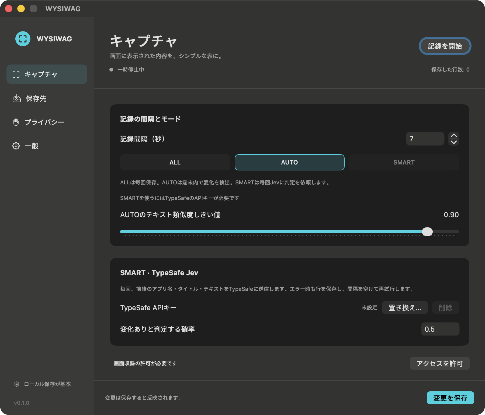

# WYSIWAG

[English](README.md)

**What you see is what AI Get.** アクティブなアプリの画面から文字を読み取り、滞在時間とともにシンプルな表へ記録するmacOSメニューバーアプリです。ローカルCSVを常に正本とし、必要に応じてNotionやGoogleスプレッドシートにも保存します。

Swift 6 / macOS 14以上 / SwiftUI / ScreenCaptureKit / Visionによる端末内OCR（英語・日本語）/ 外部ランタイム依存なし / MIT。



[英語の設定画面](docs/screenshots/settings-en.png)。GIFプレースホルダー：画面から表に記録する短いデモをここに掲載予定です。

## ビルド・インストール

Swift 6対応のXcodeをインストールし、必要に応じて`xcode-select`で選択してください。

```sh
swift build
swift test
scripts/build-app.sh
open dist/WYSIWAG.app
```

スクリプトは、このMacのCPU向けにアドホック署名した`WYSIWAG.app`を生成します。OCR画像・翻訳リソース・CLIも同梱します。必要に応じて`/Applications`へコピーし、そのコピーを起動してください。公証済み・Universalバイナリではありません。開発用は`CONFIGURATION=debug scripts/build-app.sh`です。

起動時は一時停止状態で、設定画面を開きます。メニューバーの「記録を開始」「記録を一時停止」で操作します。記録が有効な間は塗りつぶしの記録アイコンが表示され、状態欄に保存・変化なし・スキップ・エラーを表示します。設定画面を閉じてもメニューバーに残ります。「変更を保存」で設定を反映します。言語は初期設定でシステムに従い、「一般」で英語・日本語を選べます。

## 権限と記録対象

システム設定 → プライバシーとセキュリティで**画面収録**を許可し、**WYSIWAGを終了して再起動**してください。アドホック署名のビルド更新や移動により、再許可が必要な場合があります。macOSの同意を回避しません。

`SCScreenshotManager`で、前面ウィンドウとの重なりが最大のディスプレイを取得します。対象を前面アプリに限定し、前面ウィンドウの表示範囲で切り抜きます。アプリ名・ウィンドウタイトル・認識テキストを記録し、音声やスクリーンショットは保存しません。複数画面にまたがるウィンドウは1画面分が対象です。段組み・縦書き・動画・高速な切り替えなどではOCRや読み順が不正確になる場合があります。取得中にアプリやウィンドウが切り替わった場合、そのサンプルを破棄します。

**アクセシビリティ**を任意で許可すると、フォーカス中の安全な入力欄を追加で検出します。入力欄の値は読みません。Secure Event Inputも確認します。検出の可否は対象アプリに依存し、すべてのパスワード表示を検出するものではありません。

## 3つのモード

| モード | 動作 | 判定の通信 |
| --- | --- | --- |
| **ALL** | 取得に成功するたび保存 | なし |
| **AUTO**（初期設定） | アプリ・バンドルID・タイトルの変化を検出。その他は**直前に保存した画面**との文字2-gram Jaccard類似度を比較し、設定したしきい値未満で保存。日本語の分かち書きは不要です。 | なし |
| **SMART** | 毎回、直前に保存した画面と現在のアプリ名・タイトル・テキストをTypeSafe Jevへ送信。ローカル判定による事前の絞り込みはありません。`answers.changed.noul`が確率しきい値（初期値0.5）以上なら保存。最初のサンプルも空の基準と比較し、必ず保存します。 | TypeSafe |

取得間隔の初期値は5秒、AUTOの類似度しきい値は0.90です。取得は直列で実行し、OCRや通信が遅れても重複して取得しません。SMARTには[console.typesafe.ai](https://console.typesafe.ai/)で取得した自分のAPIキーが必要です。キーがなければ選択できません。

SMARTでエラーが発生した場合は、**変化ありとして行を保存**し、状態メニューにエラーを表示します。以降の取得で待ち時間を増やしながら再試行し、429/529の`Retry-After`を尊重します。待機中も行を保存し、AUTOへ黙って切り替えません。認証・不正なリクエスト・大きすぎる入力・不正レスポンスも機密情報を含まない状態表示で通知します。前後それぞれのテキストを最大22,000 UTF-8バイトに制限し、切り詰めの注記を付けます。メタデータと質問を含め64kコンテキストに余裕を持たせています。[API](https://docs.typesafe.ai/api/system-one)・[エラー仕様](https://docs.typesafe.ai/api/errors)。

## 保存先

### ローカルCSV（常に有効）

初期保存先は`~/Documents/WYSIWAG`。設定でフォルダを選択できます。日別ファイル名は`wysiwag-YYYY-MM-DD.csv`です。新規フォルダは0700、ファイルは0600で作成し、ローカルへの書き込みを確定してからクラウド送信キューに追加します。

```csv
timestamp,active_app,window_title,visible_text,dwell_seconds
```

- `timestamp`：取得時のISO 8601日時とローカル時差。UTCは`Z`になる場合があります。クラウド再送でも日時・時差を保持します。
- `active_app`：`NSWorkspace.frontmostApplication.localizedName`。バンドルIDは除外・変化判定のため内部で保持します。
- `window_title`：macOSが提供する前面ウィンドウのタイトル。
- `visible_text`：読み順の認識テキスト。横方向の余分な空白を正規化し、実際の`\n`改行を保持します。RFC 4180形式で引用し、引用符は二重化、レコード区切りはCRLFです。
- `dwell_seconds`：**直前に保存した行からの秒数**。セッションの最初は0です。AUTO/SMARTで保存しなかったサンプルは滞在時間をリセットしません。一時停止・アイドル中の経過時間も含むため、厳密な注視時間ではありません。アプリ再起動やローカルフォルダ変更で新しいセッションになります。最後の画面の滞在時間は、次の行がないため計測できません。

CSVは数式に見える先頭文字もそのまま保持します。任意の画面テキストを表計算ソフトへ取り込む場合はテキスト列として扱ってください。Sheets APIにはRAWで送信します。

### Notion OAuth

1. Notionの[Developer portal](https://app.notion.com/developers/connections)で、自分の**公開OAuthインテグレーション**を作成します。コンテンツの読み取り・挿入・更新権限を設定します。Marketplaceへの掲載は不要です。
2. リダイレクトURIを**`http://localhost:43871/oauth/callback`**として正確に登録します。認証待ちの間だけ`127.0.0.1`の固定ポートで受信し、ブラウザはlocalhostへ戻ります。Googleと異なり、任意のポートが登録済みURIに一致するとは仮定しません。3分でタイムアウトし、ランダムな`state`を照合します。キャンセル可能です。ポート43871を空けておいてください。
3. 「保存先」でクライアントIDを入力し、クライアントシークレットを「置き換え…」からキーチェーンへ保存します。「Notionと連携」でページ・データベースへのアクセスを許可し、「一覧を更新」で保存するデータベース／データソースを選びます。
4. 次の名前と型でプロパティを作成します：**Name**（タイトル）、**Timestamp**（日付）、**App**（セレクトまたはリッチテキスト）、**Dwell**（数値）。Notionを有効にして保存します。

アクセストークンとリフレッシュトークンは、キーチェーンの1項目に一括保存します。401時には1回更新を試みます。データベース一覧はページングし、許可されたデータソースのみを表示します。複数ソースがある場合も明示的に選択します。全文を本文の段落として保存し、1リッチテキストにつき最大2,000 UTF-16単位、1リクエストにつき100子ブロックまでとし、バイト数にも上限を設けます。残りはappend-childrenで追加し、途中経過をディスクに保存します。

APIバージョンは**2026-03-11**です。[ページ作成API](https://developers.notion.com/reference/post-page)のOpenAPIには`database_id`の選択肢も残っていますが、現在のガイドはデータソースの親を案内しています。WYSIWAGはデータベースからソースを解決し、明示的に`data_source_id`で作成します。[認証](https://developers.notion.com/guides/authorization/overview)・[トークン作成](https://developers.notion.com/reference/create-a-token)・[更新](https://developers.notion.com/reference/refresh-a-token)・[制限](https://developers.notion.com/reference/request-limits)。

**実環境の検証範囲**：公式認証ガイドは登録URIとの一致を要求していますが、ネイティブアプリで許可されるURIスキームを明示的に列挙していません。ループバックの処理は実装しローカルで検証済みです。実際の公開インテグレーション管理画面でのURI受理とブラウザ同意は、ユーザーの認証情報がないため未検証です。カスタムURLスキーム対応は主張しません。

### Googleスプレッドシート OAuth

1. [Google Cloud Console](https://console.cloud.google.com/)でプロジェクトを作成し、**Google Sheets API**を有効にします。
2. Google Auth Platformで同意画面と対象ユーザーを設定します。ExternalのTesting状態では自分のアカウントをテストユーザーに追加します。
3. 種類が**デスクトップアプリ**のOAuthクライアントを作成し、クライアントIDを入力します。シークレットが必要な場合は任意のシークレット欄から保存します。
4. 「Googleでログイン」を選びます。システムブラウザを開き、PKCE S256・ランダムstate・一時ポートのループバックリダイレクトで認証します。リフレッシュトークンはキーチェーン、アクセストークンはメモリのみに保持します。
5. スプレッドシートとシートを用意し、URLからスプレッドシートIDと正確なシート名を入力します。5つのCSV見出しは自分で先頭行に追加してください。保存先を有効にして設定を保存します。

既存のIDで指定した表へ書き込むため、スコープは`https://www.googleapis.com/auth/spreadsheets`です。認可されたアカウントの表へアクセスできる権限ですが、アプリは設定した保存先だけに書き込みます。テスト状態のGoogleクライアントではトークンの有効期限により再ログインが必要になる場合があります。[デスクトップOAuthガイド](https://developers.google.com/identity/protocols/oauth2/native-app)。

[`values:append`](https://developers.google.com/workspace/sheets/api/reference/rest/v4/spreadsheets.values/append)に`valueInputOption=RAW`で追記します。49,000 UTF-16単位を超えるセルには切り詰めの注記を付けます。**ローカルCSVには全文が残ります。**

### 再試行と復旧

複数のクラウド保存先を同時に有効化できます。送信待ちデータは`~/Library/Application Support/WYSIWAG/Outbox`に行・保存先ごとに保持します。本文は含みますが、認証情報は含みません。失敗したジョブは再起動後も残り、待ち時間を増やして再試行します。設定・認証エラー、または12回の失敗で停止し、原因を直した後「停止中の送信を再試行」で再開します。保存先を無効化・変更すると一致しないジョブは送信しません。元の保存先を再び有効にすると再開できます。

配送は**at least once**です。サーバーで保存後に応答が失われたりクラッシュしたりすると、クラウド側で行・ブロックが重複する場合があります。CSVを正本としてください。ディスクエラーでは記録を一時停止して通知します。CSVの確定からキュー保存までの間にクラッシュやディスク障害が起きた行は、ローカルのみに残る可能性があります。v0.1にはCSVからの自動再投入ツールはありません。壊れたキューファイルを黙って削除しません。自動削除する保持期間はないため、空き容量を管理してください。

## Macの外へ送られる情報

初期設定では何も送信しません。テレメトリや自動更新チェックもありません。

| 有効にした機能 | 送信先と内容 |
| --- | --- |
| SMART | 前後のアプリ名・タイトル・切り詰めたOCRテキスト・質問・APIキー → `api.typesafe.ai`。画像・音声・バンドルIDは送りません。 |
| Notion | アプリ名と日時のタイトル、日時、アプリ、滞在秒数、OCR全文 → `api.notion.com`。OAuth認証情報・コード・更新もNotionへ送ります。データベース一覧で許可済みメタデータを取得します。 |
| Google Sheets | 日時、アプリ、タイトル、必要に応じて切り詰めた本文、滞在秒数 → `sheets.googleapis.com`。認証・トークン更新はGoogleの認証先へ送ります。 |

設定した秘密情報は、macOSキーチェーンの汎用パスワード、サービス名`com.wysiwag.app`、`kSecAttrAccessibleAfterFirstUnlockThisDeviceOnly`でのみ保存します。画面には設定済み／未設定と置き換え・削除・OAuthログイン操作だけを表示します。HTTPレスポンス本文や任意のエラー詳細、URLは診断ログへ出しません。OCR本文の標準出力は明示的に指定したCLIのdry-runのみです。

## プライバシー初期設定

1Password、キーチェーンアクセス、**システム設定全体**（パスワード設定画面を保守的に保護）、WYSIWAG自身、検出できる安全な入力、画面ロック中、5分以上操作のない状態をスキップします。アプリ名／バンドルIDとアイドル時間を変更できます。記録の一時停止中も、有効な保存先への既存ジョブは送信されます。送信も止める場合は保存先を無効にしてください。既に送信したHTTPリクエストは取り消せません。

CSVと送信待ちデータは暗号化されていないローカルテキストです。OSの同期対象フォルダを選ぶと、WYSIWAG以外の機能で同期される可能性があります。機密情報を完全に検出するものではないため、対象アプリを適切に除外してください。

## 開発・検証

```sh
scripts/verify.sh
scripts/core-e2e.sh
scripts/app-e2e.sh
swift run wysiwag-cli capture --once --dry-run
swift run wysiwag-cli capture --once --dry-run --live
```

通常のdry-runは、同梱した合成の英日画像に対して実際のVision OCRを実行します。画面収録の権限は不要ですが、ライブ画面取得の許可を証明するものではありません。Core E2EはローカルHTTPサーバーを使い、3モード、毎回のJev呼び出し、実CSVと正確な滞在時間、Notion/Sheetsの制限、429、通信障害後の永続キュー復旧を検証します。CIはmacOSで実行します。App E2Eにはログイン中のデスクトップ、Orca、アクセシビリティ自動操作の許可が必要です。テスト専用の設定とキーチェーンを使います。

[機能マップ](docs/verification/feature-map.md)、[QAログ](docs/verification/qa-log.md)、[証跡](docs/verification/evidence/README.md)を参照してください。実際のクラウド同意と書き込みには自分のアカウントが必要です。モックの成功を本番環境での確認として扱いません。

## 類似プロジェクト

関連する取り組みとして、次のプロジェクトがあります。

| プロジェクト | 主な用途 |
| --- | --- |
| [Screenpipe](https://github.com/screenpipe/screenpipe) | 画面・音声履歴をAIのコンテキストに活用 |
| [rem](https://github.com/jasonjmcghee/rem) | Macで見た内容のローカル記録と検索 |
| [OpenRecall](https://github.com/openrecall/openrecall) | オープンソースのデジタル履歴検索 |
| [TimeScroll](https://github.com/XInTheDark/TimeScrollApp) | 検索できる画面記録と過去へのスクロール |
| [Rewisp](https://github.com/yashmitb/Rewisp) | テキストによる画面の記憶と質問応答 |
| [Dayflow](https://github.com/JerryZLiu/Dayflow) | 自動作業日誌と活動タイムライン |
| [ActivityWatch](https://activitywatch.net/) | ローカルのアプリ・ウィンドウ利用時間計測 |
| [ScreenMemory](https://screenmemory.app/) | スクリーンショット履歴とテキスト検索 |
| [Rewind / Limitless](https://www.limitless.ai/) | Meta買収後にRewindの画面記憶機能は終了。LimitlessはPendantの新規販売を停止し、既存ユーザーを2026年中サポートすると案内 |

WYSIWAGは、**滞在時間付きのCSV／Notion／Sheetsの表**と、機械的なAUTO・Jevによる変化時のみ保存するSMARTに焦点を当てています。検索可能な記憶アプリのUIは提供しません。
