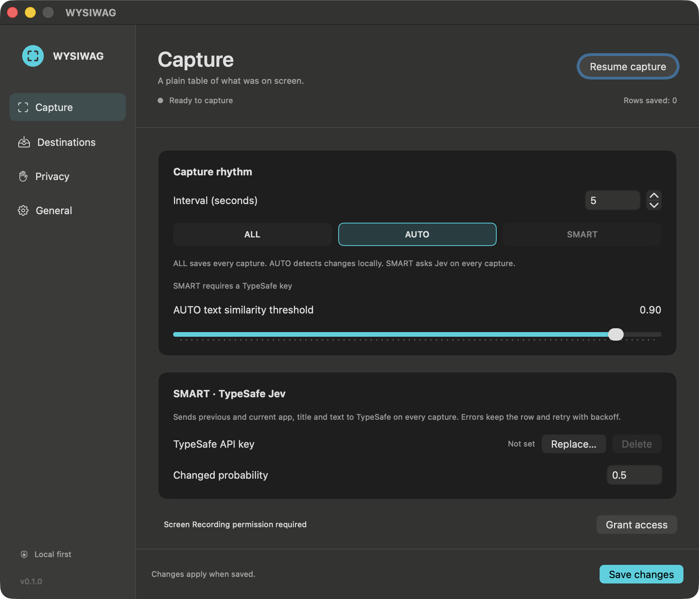

# WYSIWAG

[日本語](README.ja.md)

**What you see is what AI Get.** A macOS menu bar app that turns the active app's visible text into a plain table, with time spent between recorded screens. Local CSV is always the source of truth; Notion and Google Sheets are optional copies.

Swift 6 · macOS 14+ · SwiftUI · ScreenCaptureKit · on-device Vision OCR (English + Japanese) · no third-party runtime dependencies · MIT.



[Japanese settings](docs/screenshots/settings-ja.png). GIF placeholder: a short capture → table walkthrough will go here.

## Build and install

Install Xcode with the Swift 6 toolchain and select it with `xcode-select` if necessary.

```sh
swift build
swift test
scripts/build-app.sh
open dist/WYSIWAG.app
```

The script builds an **ad-hoc signed**, runnable app for your Mac's architecture, including its resource bundles and `wysiwag-cli`. Copy `dist/WYSIWAG.app` to `/Applications` if desired and launch that copy. It is not notarized or a universal binary. Use `CONFIGURATION=debug scripts/build-app.sh` for development.

The app starts paused and opens Settings. Use the menu bar's **Resume capture** / **Pause capture**. A filled recording symbol indicates capture is enabled; status explains saved, unchanged, privacy-skipped and error states. Closing Settings leaves the menu bar app running. Changes apply with **Save changes**. English follows the system by default; choose English or Japanese under General.

## Permissions and capture boundaries

Grant **Screen Recording** in System Settings → Privacy & Security, then **quit and restart WYSIWAG**. An ad-hoc rebuild or moving the app can require granting access again. The app does not bypass macOS consent.

Capture uses `SCScreenshotManager` on the display containing most of the frontmost window, restricting the composition to the frontmost app and cropping to that window's intersection with the display. It records the active app name, window title and recognized text. It does not record audio or save screenshots. Windows spanning displays are sampled on one display. OCR is approximate; column layout, vertical text, animation and rapidly switching windows may not reproduce human reading order exactly. App/window changes during capture cause that sample to be discarded.

Optional **Accessibility** permission improves focused secure-text-field detection; no field values are read through Accessibility. Secure Event Input is also checked. Detection depends on the app and is not a universal password detector.

## Three modes

| Mode | Behavior | Network for detection |
| --- | --- | --- |
| **ALL** | Save every successful capture | None |
| **AUTO** (default) | App/bundle or title changes are changes. Otherwise compare normalized text to the **previous written screen** using character-bigram Jaccard similarity (works without Japanese word boundaries). Save below the configurable threshold. | None |
| **SMART** | Send previous written + current app/title/text to TypeSafe Jev for **every capture**, without a heuristic pre-filter. Save when `answers.changed.noul` meets the configurable probability threshold (default 0.5). The first sample is always kept and is also classified against an empty baseline. | TypeSafe |

Default interval: 5 seconds. Captures are serial: slow OCR or a classifier request does not cause overlapping captures. AUTO's default similarity threshold is 0.90. SMART is unavailable without your own TypeSafe key from [console.typesafe.ai](https://console.typesafe.ai/).

SMART errors **keep the row as changed**, show an error in the status menu, and retry on later captures with bounded exponential backoff. `Retry-After` is respected for 429/529. The deadline survives settings changes and relaunch; switching to ALL/AUTO clears the displayed SMART error without resetting its cooldown. Rows during cooldown are also kept; the app never silently substitutes AUTO. Invalid requests, credentials, oversized input and malformed responses are surfaced through sanitized status messages. Each text is capped at 22,000 UTF-8 bytes with a truncation note, leaving ample space below the 64k context for metadata and the question. See the [System One API](https://docs.typesafe.ai/api/system-one) and [error rules](https://docs.typesafe.ai/api/errors).

## Destinations

### Local CSV (always enabled)

Choose a folder; the default is `~/Documents/WYSIWAG`. A daily file is named `wysiwag-YYYY-MM-DD.csv`. Newly created directories/files use owner-only permissions (0700/0600). A write-ahead journal records the CSV bytes and all enabled destination intents together. CSV data and its `.csv.offset` checkpoint are flushed before the corresponding outbox batch becomes eligible for delivery. Recovery completes interrupted appends before recording again, including multiline quoted fields; legacy files without a checkpoint retain their last complete RFC 4180 record.

```csv
timestamp,active_app,window_title,visible_text,dwell_seconds
```

- `timestamp`: ISO 8601 at capture time, with the local offset (UTC may use `Z`). Date and offset are frozen for cloud replay.
- `active_app`: `NSWorkspace.frontmostApplication.localizedName`. Bundle ID is retained internally for privacy and change detection.
- `window_title`: frontmost window title when macOS supplies it.
- `visible_text`: all recognized text in reading order, normalized horizontal whitespace, actual `\n` line breaks inside RFC 4180 quoted fields. Quotes are doubled; record separators are CRLF.
- `dwell_seconds`: seconds **since the previous written row**; first row of a recording session is 0. In SMART/AUTO, unchanged samples do not reset dwell. Pause/idle gaps are included; this is sampled elapsed time, not an exact attention measurement. Relaunch or changing the local folder starts a new session. The final screen has no subsequent row to measure its dwell.

CSV preserves text verbatim, including leading formula characters. When importing arbitrary screen text into a spreadsheet, use text columns. Sheets API writes use RAW.

### Notion OAuth

1. Create your own **public OAuth integration** in Notion's [Developer portal](https://app.notion.com/developers/connections), with read, insert and update content capabilities. Marketplace listing is not required.
2. Register the exact redirect URI **`http://localhost:43871/oauth/callback`**. WYSIWAG binds only `127.0.0.1` on that fixed port while sign-in is pending; the browser returns via localhost. Unlike Google, an arbitrary ephemeral port is not assumed to match Notion's registered redirect. The listener expires after three minutes, validates a random `state`, and supports cancellation. Port 43871 must be free.
3. In Destinations, enter the client ID and use **Replace…** to put the client secret in Keychain. Click **Connect Notion**, approve the desired pages/databases, then **Refresh list** and choose the granted database/data source.
4. Prepare these exact properties: **Name** (title), **Timestamp** (date), **App** (select or rich_text), **Dwell** (number). Enable Notion and save.

The OAuth access/refresh pair is stored atomically in Keychain. An expired access token can be refreshed once after a 401. Search is paginated and restricted to data sources visible to the authorization; multi-source databases are selected explicitly. Notion stores full OCR text as paragraphs, at most 2,000 UTF-16 units per rich text item and 100 children per request, with an additional payload-byte budget. Remaining paragraphs use append-children and checkpoint progress on disk.

API version: **2026-03-11**. The [create-page reference](https://developers.notion.com/reference/post-page) still includes a `database_id` variant in its OpenAPI, while its guide directs new database rows to a data source parent. WYSIWAG resolves the database and writes explicit `data_source_id` parents, avoiding ambiguity. See [authorization](https://developers.notion.com/guides/authorization/overview), [token exchange](https://developers.notion.com/reference/create-a-token), [refresh](https://developers.notion.com/reference/refresh-a-token), and [limits](https://developers.notion.com/reference/request-limits).

**Live verification boundary:** the official authorization guide requires an exact registered redirect but does not explicitly enumerate permitted native-app URI schemes. The loopback flow is implemented and tested locally; acceptance of this URI in a real public-integration portal and live browser consent are not verified without user-supplied credentials. No custom-scheme support is claimed.

### Google Sheets OAuth

1. In [Google Cloud Console](https://console.cloud.google.com/), create a project and enable the **Google Sheets API**.
2. Configure Google Auth Platform's consent screen/audience. For an External app in Testing, add your Google account as a test user.
3. Create an OAuth client with application type **Desktop app**. Copy its client ID into WYSIWAG; if your client requires a secret, save it using the optional client-secret Replace button.
4. Click **Sign in with Google**. WYSIWAG opens the system browser, uses PKCE S256, a random state and an ephemeral loopback redirect, then stores the refresh token in Keychain. An access token stays in memory only.
5. Create a spreadsheet and a sheet. Enter the spreadsheet ID from its URL and the exact sheet name. Add the five CSV header cells yourself, enable Google Sheets, and save.

The scope is `https://www.googleapis.com/auth/spreadsheets` because you supply an existing spreadsheet ID. This scope permits access to spreadsheets authorized by the account; the app writes only the configured target. Google may expire refresh tokens for test-mode clients, requiring sign-in again. See Google's [desktop OAuth guide](https://developers.google.com/identity/protocols/oauth2/native-app).

Rows append via [`values:append`](https://developers.google.com/workspace/sheets/api/reference/rest/v4/spreadsheets.values/append) with `valueInputOption=RAW`. Any cell exceeding 49,000 UTF-16 units is shortened with a marker. **The CSV keeps the full text.**

### Retry queue and recovery

Cloud destinations can run together. Pending jobs (including captured text, never credentials) live in `~/Library/Application Support/WYSIWAG/Outbox`, one batch per row containing all enabled destinations (older single-job files remain readable). Failures retain jobs across relaunch. Exponential backoff and `Retry-After` prevent rapid retry loops; configuration/authentication errors or 12 failed attempts require **Retry blocked writes** after fixing the problem. Disabled or changed targets stop sending unmatched jobs; re-enable the original target to resume them.

Delivery is **at least once**, not exactly once: a lost response or a crash after a remote commit can produce duplicate cloud rows/blocks. The local CSV remains authoritative. A durable `.txn` journal repairs interrupted CSV/outbox commits using stable job identities; a batch cannot send while its journal remains. Disk errors pause capture. Recovery reconciles the live comparison/dwell baseline before resuming or replacing the recorder.

Malformed job files, including valid JSON with invalid continuation progress, are retained in `Outbox/Quarantine`, and Settings reports their count. For a mixed batch, the original bytes are retained before valid sibling jobs continue. Notion continuations require a page ID and a block offset strictly within the remaining text; new pages start at block zero. An unresolved journal (for example, a missing CSV volume or damaged file) stays in place, blocks only its own batch, and appears as **Unresolved local writes**. Append recovery checks the journal’s CSV target before decoding its transaction. An unreadable or unrouteable journal remains retained with its batch gated; it cannot block captures to another day or folder. A damaged journal identifiable as belonging to the current CSV stops that CSV’s append. Restore folder access or repair the retained data before retrying. No automatic historical CSV import or retention deletion is included.

Persistence uses file and directory synchronization with macOS `F_FULLFSYNC`; a filesystem that cannot provide these operations reports a write error. Tests construct interrupted on-disk states and induce a real checkpoint-write failure; they do **not** simulate a physical power cut or certify storage hardware. Keep the CSV, checkpoints and journals together when backing up or moving data.

OAuth authorization advances a session generation. Refreshes are coalesced, credential records carry revisions, and stale responses cannot overwrite a newer session or Google’s memory cache. Background draining pauses through sign-in, and canceled loopback listeners finish closing before another attempt binds the port.

## What leaves the Mac

Nothing is sent by default. No telemetry or automatic update checks are included.

| Enabled operation | Data and recipient |
| --- | --- |
| SMART | Previous/current **app name, window title, truncated OCR text**, question and API key → `api.typesafe.ai`. No screenshots, audio or bundle ID. |
| Notion | App name + timestamp title, date, app property, dwell and full OCR text → `api.notion.com`. OAuth client credentials/code and token refresh go to Notion; database search returns authorized metadata. |
| Google Sheets | Timestamp, app, window title, possibly truncated text and dwell → `sheets.googleapis.com`; OAuth client/code/refresh traffic → Google accounts/token endpoints. |

Saved credentials live only in macOS Keychain, generic-password service `com.wysiwag.app`, accessible after first unlock on this device only. Settings show set/not set, replace/delete controls, or OAuth sign-in controls. HTTP response bodies and arbitrary errors never enter diagnostic logs. URLs are not logged. OCR text is printed only by an explicitly requested CLI dry-run.

## Privacy defaults

1Password, Keychain Access, **all of System Settings** (conservative coverage of password panes), WYSIWAG itself, detectable secure-input focus, locked screens and sessions idle over 5 minutes are skipped. Configure exact app names/bundle IDs and idle minutes in Privacy. Pause capture any time. Existing enabled cloud jobs may continue draining while capture is paused; disable the destination to stop them. An already-sent HTTP request cannot be recalled.

CSV and outbox are plain local text, not encrypted by WYSIWAG. Choose a local folder if you want local-only storage: putting it under an OS-synced folder can sync it outside WYSIWAG. Screen text can contain sensitive information that secure-field detection cannot identify.

## Verification and development

```sh
scripts/verify.sh                 # build, unit, core E2E, app packaging, secret scan
scripts/core-e2e.sh               # synthetic en/ja images + actual loopback HTTP mocks
scripts/app-e2e.sh                # visible macOS UI, isolated test settings/Keychain
swift run wysiwag-cli capture --once --dry-run
swift run wysiwag-cli capture --once --dry-run --live
```

The default CLI dry-run runs real Vision OCR on a bundled, synthetic bilingual image without requiring Screen Recording. It does not prove live ScreenCaptureKit permission. Core E2E asserts real CSV, exact dwell, ALL/AUTO/SMART, every-capture Jev calls, Notion/Sheets limits, 429 cooldown, persistent outage recovery and independently parsed CSV. CI runs on macOS. App E2E requires an unlocked desktop and accessibility automation permissions. Core E2E writes fresh reports to `.build/verification` (override with `WYSIWAG_EVIDENCE_DIR`); it never rewrites the committed OCR snapshot by default. `verify.sh` checks that snapshot remains unchanged. Recovery/session regressions cover interrupted multiline writes, destination-intent recovery, refresh versus reauthorization, task retirement, quarantined jobs and persistent Jev deadlines.

See the [feature map](docs/verification/feature-map.md), [QA log](docs/verification/qa-log.md), and [evidence report](docs/verification/evidence/README.md). Live cloud consent and writes require your own accounts and are not simulated as verified production results.

## Similar projects

These projects explore related, useful ideas:

| Project | Focus |
| --- | --- |
| [Screenpipe](https://github.com/screenpipe/screenpipe) | Screen/audio history as context for AI tools |
| [rem](https://github.com/jasonjmcghee/rem) | Local recording and search of what you viewed on Mac |
| [OpenRecall](https://github.com/openrecall/openrecall) | Open-source digital-history recall/search |
| [TimeScroll](https://github.com/XInTheDark/TimeScrollApp) | Searchable screen recordings and scrolling back through time |
| [Rewisp](https://github.com/yashmitb/Rewisp) | Text-based screen memory and questions about it |
| [Dayflow](https://github.com/JerryZLiu/Dayflow) | Automatic work journal and activity timeline |
| [ActivityWatch](https://activitywatch.net/) | Local app/window activity and time tracking |
| [ScreenMemory](https://screenmemory.app/) | Screenshot history and text search |
| [Rewind / Limitless](https://www.limitless.ai/) | Rewind screen memory was discontinued after Meta's acquisition; Limitless stopped new Pendant sales and says existing Pendant customers remain supported throughout 2026 |

WYSIWAG's focus is a **plain CSV/Notion/Sheets table with dwell time**, mechanical AUTO and change-only Jev SMART. It does not provide a searchable-memory interface.
